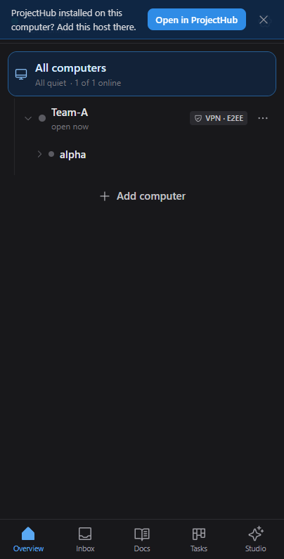
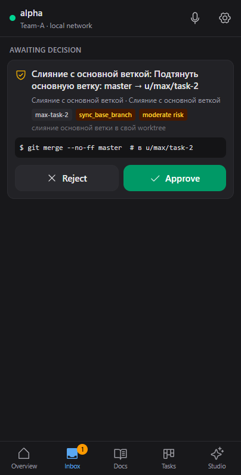
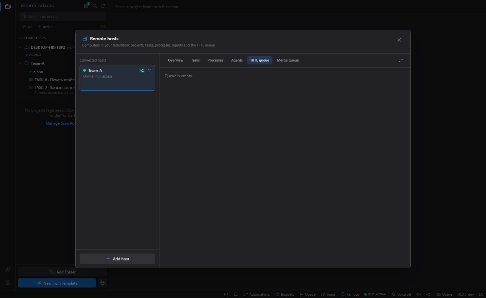

Remote Control позволяет следить за ProjectHub на вашем компьютере и управлять им с телефона, из браузера, из Telegram или с другого компьютера. Агенты, задачи, процессы и одобрения продолжают работать на компьютере; удалённое устройство показывает их и передаёт ваши решения обратно.

## Включите Remote Control

1. Нажмите **Remote** в строке состояния внизу окна. Откроется окно **Удаленное управление (Remote & Telegram)**.
2. Нажмите **Включить**.
3. На вкладке **Подключение и QR** появятся QR-код, **Адреса в QR** и ссылка для клиента в браузере.

В окне четыре вкладки: **Подключение и QR**, **Telegram Mini App**, **Устройства** и **Настройки сети**.

## Сопряжение приложения для Android

1. Проверьте, что телефон и компьютер в одной сети Wi-Fi. Если Windows спросит про брандмауэр для ProjectHub, разрешите **частные сети**.
2. В приложении нажмите **Сканировать QR-код**, разрешите доступ к камере и наведите её на QR-код в окне Remote Control.
3. Если включено **Требовать подтверждение хоста при первом подключении устройства**, подтвердите телефон на вкладке **Устройства** кнопкой **Разрешить доступ**.

После сопряжения приложение подключается само; после перезапуска сканировать QR-код снова не нужно. Если ProjectHub на компьютере переустанавливали или перевыпустили его ключ, отсканируйте QR-код заново.

## Клиент в браузере

Десктопное приложение также раздаёт веб-клиент для телефонов. Он шифрует весь трафик в браузере, а браузеры разрешают это только на страницах HTTPS, поэтому клиент в браузере не подключается по обычному адресу `http://` в локальной сети.

1. В окне Remote Control нажмите **Запустить туннель**. Через 5–15 секунд появится адрес `https://…trycloudflare.com`, и он добавится в **Адреса в QR**.
2. Отсканируйте QR-код камерой телефона или воспользуйтесь кнопками **Скопировать ссылку** / **Открыть в браузере** в блоке **Прямая ссылка веб-клиента**.
3. Если требуется подтверждение, подтвердите устройство на вкладке **Устройства**.

## Шифрование и права устройств

- Трафик между устройством и компьютером зашифрован сквозным шифрованием (AES-256-GCM). Туннель или релей посередине видят только шифртекст.
- QR-код несёт ключ компьютера. При каждом подключении приложение проверяет подпись компьютера. Если кто-то подставит другой ключ, приложение остановится с сообщением, что компьютер не подтвердил свой ключ, и ничего не отправит.
- Каждое устройство получает свой токен; его можно отозвать на вкладке **Устройства** кнопкой **Отозвать доступ**.
- У каждого устройства есть права: **Только чтение**, **Только HITL** (только решения) или **Полный доступ**. В **Режиме только для чтения (Read-Only)** телефон не может останавливать процессы и делать коммиты.
- С телефона нельзя запустить произвольную команду: доступны только действия проекта Run, Test и Deploy (Deploy — с подтверждением), а также остановка и перезапуск процессов.

## Одобрение шагов агентов с телефона

Экран **Входящие** в приложении собирает всё, что ждёт вас, со всех сопряжённых компьютеров:

- **Ждут решения** — запросы агентов на одобрение, с кнопками **Одобрить** и **Отклонить**.
- **Задачи от агентов** — задачи, которые завели агенты и которые нужно подтвердить.
- **На проверке** — задачи в Review.
- **События** — агент закончил работу или упал, сбой автоматизации, сообщение от агента.

У каждого запроса есть класс риска, его определяет компьютер:

| Риск | Примеры | Одобрить с телефона |
|---|---|---|
| Низкий | Чтение, `git status`, тесты, линт | Да |
| Средний | Запись в проекте, `npm install`, сборка, коммит | Да, в приложении и кнопкой бота Telegram |
| Высокий | `git push`, удаление, сеть, секреты, запись вне проекта, управление компьютером, неизвестный инструмент | На компьютере или в приложении для Android с подтверждением биометрией |

Отклонить запрос с телефона можно всегда. Компьютер сам проверяет класс риска и не верит телефону на слово. Срабатывает первый ответ с любого устройства.

Пока ждёт запрос или работает агент, запущенный с телефона, компьютер не уходит в сон. Отключается это в **Настройки сети → Не давать ПК уснуть, пока агент ждёт решения**.

### Проверка задачи с телефона

Нажмите на задачу в разделе **На проверке**. Откроются критерии приёмки с вердиктом цикла «До готовности», проверки со статусом и вывод упавших проверок.

- **Принять** переводит задачу в Done.
- **Вернуть** отправляет её обратно в работу с вашим комментарием, он попадает в заметки задачи. **Перезапустить агента** снова запускает ту же роль с вашим комментарием в промпте; для этого нужен полный доступ.

### Agents Studio на телефоне

Экран **Studio** показывает те же сессии, что Agents Studio на компьютере. Можно продолжить сессию, начать новую с любым аккаунтом, настроенным на этом компьютере, выбрать модель и режим, остановить ответ. Промпт, отправленный с телефона, выполняется на компьютере.

## Вне дома

Приложение хранит все адреса компьютера и пробует их по порядку: локальная сеть, туннель, релей. Первым идёт адрес, который сработал в прошлый раз. Когда адреса компьютера меняются, он отправляет новые телефону при следующем подключении.

Чтобы связаться с компьютером из-за пределов локальной сети:

- **Быстрый туннель.** **Запустить туннель** в окне Remote Control. Настраивать ничего не нужно, но адрес меняется при каждом перезапуске туннеля или ProjectHub. Держите туннель включённым, только пока он нужен.
- **Именованный туннель Cloudflare.** Постоянный адрес на вашем домене, подключённом к Cloudflare. Направьте туннель на `localhost:42050` и впишите его адрес `https://` в поле **Публичный URL WebApp** на вкладке **Telegram Mini App**.
- **Свой релей.** Сервер с доменом и TLS. Впишите его адрес `wss://` в **Настройках сети**. Компьютер подключается к релею сам, входящие порты не нужны. Через релей идёт только шифртекст.

После настройки нового пути отсканируйте QR-код ещё раз или один раз подключитесь дома, чтобы телефон получил новый адрес.

## Telegram Mini App и бот

Mini App — тот же клиент внутри Telegram. Бот присылает уведомления, например об упавших процессах и запросах одобрения, и даёт кнопки для одобрения запросов среднего риска.

1. В Telegram создайте бота в **@BotFather** командой `/newbot`.
2. На вкладке **Telegram Mini App** заполните **Telegram Bot Token (из @BotFather)**, **Юзернейм бота (без @)** и **Ваш Telegram Chat ID**.
3. Запустите туннель: Telegram требует адрес HTTPS.
4. В @BotFather отправьте `/newapp`, выберите бота и укажите адрес Mini App.
5. Нажмите **Сохранить настройки Telegram** и отправьте тестовое сообщение.

## Несколько компьютеров

### Один телефон, несколько компьютеров

- Чтобы добавить компьютер, откройте в приложении **Компьютеры → Добавить компьютер** и отсканируйте QR-код этого компьютера. Первый остаётся в списке.
- Сопряжения независимы: у каждого компьютера свой идентификатор устройства, ключ и токен, и компьютеры не узнают, что телефон один и тот же.
- Переключатель **Компьютеры** показывает для каждого компьютера статус, путь связи и число ожидающих запросов.
- **Забыть этот компьютер** удаляет ключ и токен только этого компьютера.

### Компьютеры, которые видят друг друга

Несколько компьютеров с ProjectHub можно объединить в федерацию. Подключённый компьютер появляется в окне **Удалённые хосты**: его проекты, задачи, процессы, агенты и очередь одобрений видны в том же окне.

Связать два компьютера можно тремя способами:

- **Ссылка для другого ПК.** Скопируйте её в окне Remote Control одного компьютера и откройте на другом; ProjectHub предложит добавить первый компьютер.
- **С телефона.** Когда сопряжены хотя бы два компьютера с полным доступом, **Компьютеры → Познакомить компьютеры** связывает их в обе стороны.
- **Вручную.** **Удалённые хосты → Добавить хост**, с идентификатором хоста, ключом и PIN сопряжения из окна Remote Control другого компьютера.

Задачу можно отправить агенту на конкретном компьютере: укажите в поле **Исполнитель** значение `agent:<роль>@<хост>`. Автозапуск назначенных задач по умолчанию выключен.

В macOS разрешите ProjectHub доступ к **локальной сети**, иначе он не сможет связаться с другими компьютерами в вашей локальной сети.
